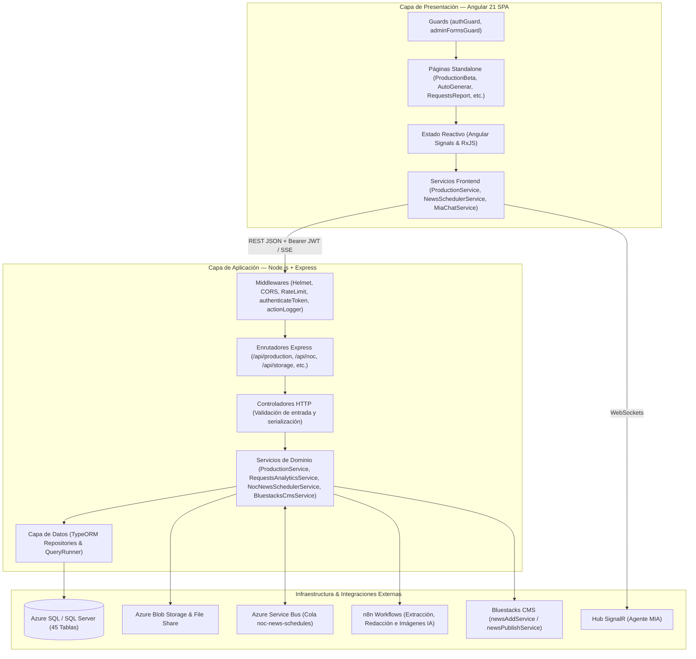
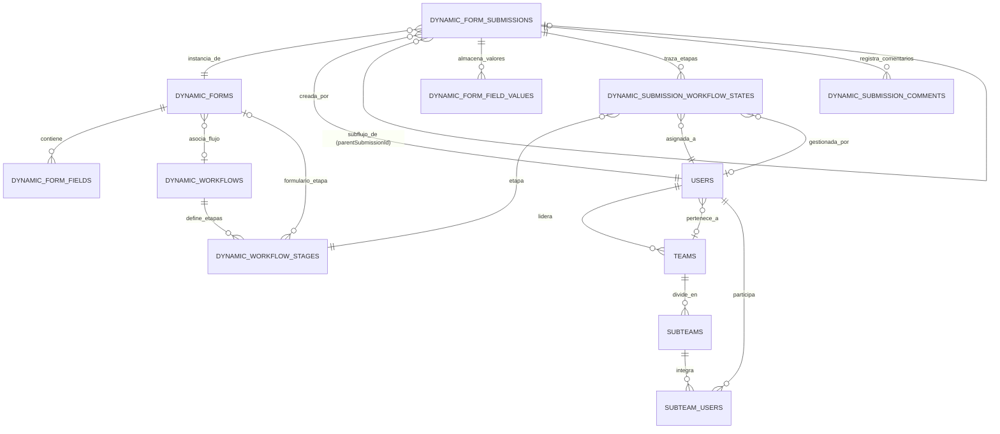
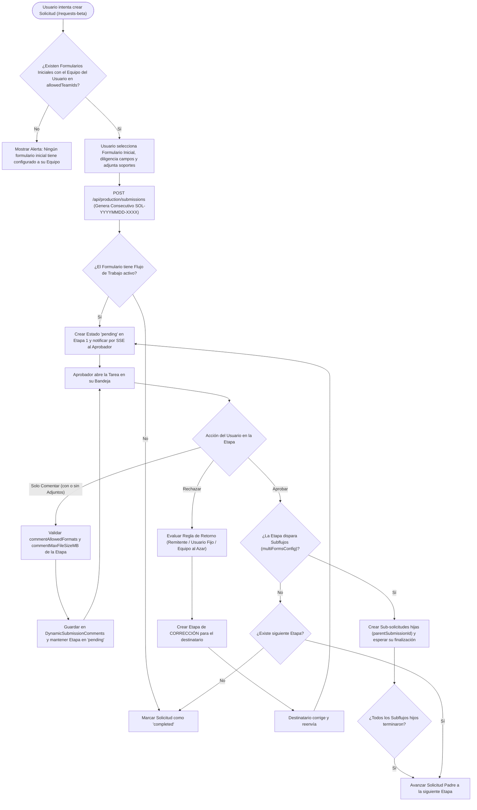
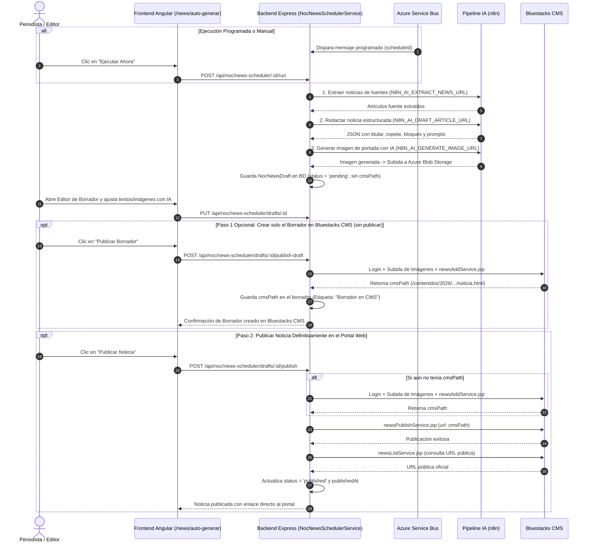
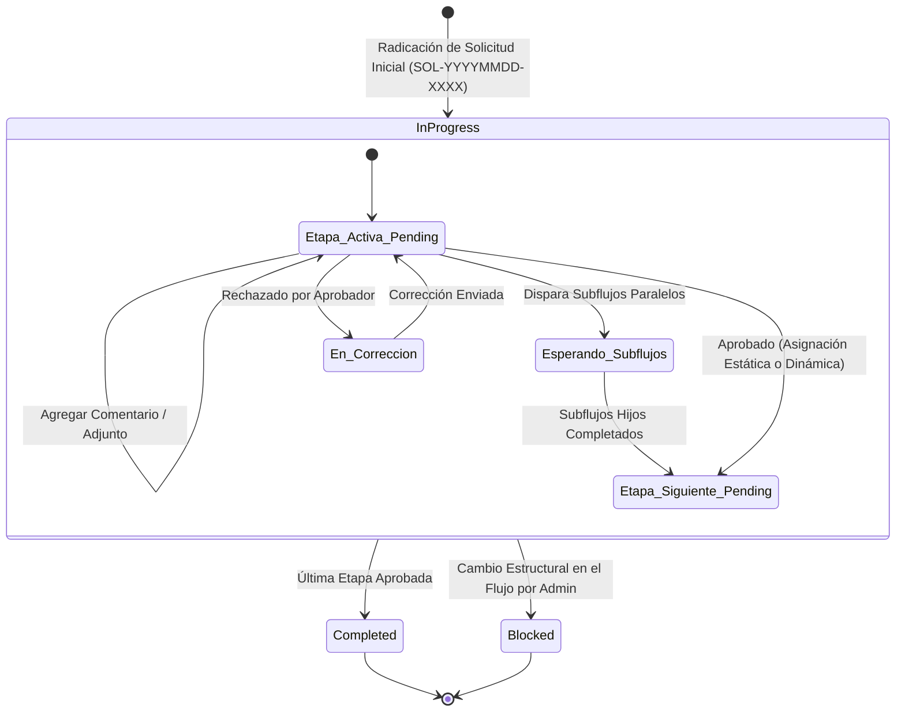

# VOC & NOC — Plataforma Integral de Conciliaciones, Producción, Flujos de Trabajo BPMN y Automatización Editorial

[](./backend/src/app.ts)
[](https://nodejs.org/)
[](https://www.typescriptlang.org/)
[](https://angular.dev/)
[](https://primeng.org/)
[](https://expressjs.com/)
[](https://typeorm.io/)
[](https://www.microsoft.com/sql-server)
[](https://azure.microsoft.com/)
[](./terraform/README.md)

---

## 📑 Tabla de Contenido

1. [Visión General del Ecosistema](#1-visión-general-del-ecosistema)
2. [Documentación Funcional por Módulo y Pantalla](#2-documentación-funcional-por-módulo-y-pantalla)
   - [2.1. Motor de Formularios Dinámicos y Flujos de Trabajo BPMN (`/requests-beta/admin`)](#21-motor-de-formularios-dinámicos-y-flujos-de-trabajo-bpmn-requests-betaadmin)
   - [2.2. Bandeja de Solicitudes Dinámicas y Aprobaciones (`/requests-beta`)](#22-bandeja-de-solicitudes-dinámicas-y-aprobaciones-requests-beta)
   - [2.3. Informe Analítico y Ejecutivo de Solicitudes (`/requests-report` y `/requests-report_2`)](#23-informe-analítico-y-ejecutivo-de-solicitudes-requests-report-y-requests-report_2)
   - [2.4. Gestión de Producción Publicitaria, Pautas y Asistente MIA (`/requests`, `/mia`, `/campaign-scheduling`)](#24-gestión-de-producción-publicitaria-pautas-y-asistente-mia-requests-mia-campaign-scheduling)
   - [2.5. Generador y Programador Automático de Noticias con IA y Bluestacks CMS (`/news/auto-generar`)](#25-generador-y-programador-automático-de-noticias-con-ia-y-bluestacks-cms-newsauto-generar)
   - [2.6. Analítica de Portal NOC: Dashboard, Ingresos, Presupuesto y Cobertura 15 Minutos](#26-analítica-de-portal-noc-dashboard-ingresos-presupuesto-y-cobertura-15-minutos)
   - [2.7. Gestión Comercial, Clientes, Carga Documental e Histórico de OC](#27-gestión-comercial-clientes-carga-documental-e-histórico-de-oc)
   - [2.8. Administración de Usuarios, Equipos, Subequipos, Menús y Permisos RBAC](#28-administración-de-usuarios-equipos-subequipos-menús-y-permisos-rbac)
   - [2.9. Centro de Diagnóstico y Salud del Sistema (`/system-health`)](#29-centro-de-diagnóstico-y-salud-del-sistema-system-health)
3. [Estructura Completa del Monorepo](#3-estructura-completa-del-monorepo)
4. [Stack Tecnológico Detallado](#4-stack-tecnológico-detallado)
5. [Arquitectura Técnica, Principios SOLID y Patrones de Diseño](#5-arquitectura-técnica-principios-solid-y-patrones-de-diseño)
   - [Arquitectura en Capas y Flujo de Datos](#arquitectura-en-capas-y-flujo-de-datos)
   - [Principios SOLID Aplicados](#principios-solid-aplicados)
   - [Patrones de Diseño Implementados](#patrones-de-diseño-implementados)
   - [Segregación de Responsabilidades: Backend vs. Frontend](#segregación-de-responsabilidades-backend-vs-frontend)
6. [Modelo de Datos y Diagramas de Procesos](#6-modelo-de-datos-y-diagramas-de-procesos)
   - [Catálogo de las 45 Entidades de Base de Datos (TypeORM)](#catálogo-de-las-45-entidades-de-base-de-datos-typeorm)
   - [Diagrama Entidad-Relación (ERD) del Núcleo Dinámico y Organizacional](#diagrama-entidad-relación-erd-del-núcleo-dinámico-y-organizacional)
   - [Diagrama de Flujo del Motor de Solicitudes, Subflujos y Aprobaciones](#diagrama-de-flujo-del-motor-de-solicitudes-subflujos-y-aprobaciones)
   - [Diagrama de Secuencia del Pipeline Editorial IA + Bluestacks CMS](#diagrama-de-secuencia-del-pipeline-editorial-ia--bluestacks-cms)
   - [Diagrama de Estados del Ciclo de Vida de Solicitudes](#diagrama-de-estados-del-ciclo-de-vida-de-solicitudes)
7. [Catálogo Completo de Endpoints de la API REST](#7-catálogo-completo-de-endpoints-de-la-api-rest)
8. [Variables de Entorno y Monitoreo Obligatorio en `/health`](#8-variables-de-entorno-y-monitoreo-obligatorio-en-health)
9. [Protocolo de Versionamiento Semántico (SemVer)](#9-protocolo-de-versionamiento-semántico-semver)
10. [Instalación, Ejecución Local y Migraciones de Base de Datos](#10-instalación-ejecución-local-y-migraciones-de-base-de-datos)
11. [Infraestructura como Código (Terraform) y Despliegue CI/CD en Azure](#11-infraestructura-como-código-terraform-y-despliegue-cicd-en-azure)
12. [Seguridad, Auditoría y Control de Acceso](#12-seguridad-auditoría-y-control-de-acceso)
13. [Diagnóstico y Solución de Problemas (Troubleshooting)](#13-diagnóstico-y-solución-de-problemas-troubleshooting)

---

## 1. Visión General del Ecosistema

**VOC & NOC** es una plataforma empresarial unificada construida bajo arquitectura de **Monorepo** (`npm workspaces`) que integra la operación comercial, el motor de solicitudes y flujos de aprobación dinámicos, la conciliación publicitaria y la automatización editorial impulsada por Inteligencia Artificial para **Claro Media / Red+ Noticias / Azemblia**.

La plataforma se divide funcionalmente en dos grandes dominios que conviven dentro de una única Single Page Application (Angular 21) respaldada por un API Server transaccional (Node.js + Express + TypeORM + SQL Server):

1. **VOC (Voice of Customer — Operaciones, Producción, Comercial y Flujos Dinámicos):**
   - **Motor No-Code de Formularios y Flujos de Trabajo BPMN:** Creación y administración de formularios dinámicos, reglas de visibilidad condicional, control de acceso por equipos para radicación de formularios iniciales, flujos de trabajo multi-etapa, subflujos paralelos, reglas de rechazo, asignación inteligente (usuario fijo, azar en equipo/subequipo, menor carga laboral, líder, jefe directo o elección manual desde la etapa previa) y adjuntos con validación de extensión y peso por etapa.
   - **Gestión de Producción y Pautas Publicitarias:** Radicación y seguimiento de solicitudes de producción, agendamiento de campañas, definición de audiencias y objetivos, registro de materiales, control de ANS (SLA) en días y horas hábiles de Colombia e integración de chat en tiempo real con el agente **MIA** (`@microsoft/signalr`).
   - **Analítica Operativa e Informes de Solicitudes:** Tableros ejecutivos con indicadores de rendimiento (KPIs), cuellos de botella por etapa, tiempos de ciclo, cumplimiento por área/equipo y exportación avanzada a Excel.
   - **Repositorio Comercial y Gestión de Clientes:** Administración del directorio de clientes, carga masiva, consulta de órdenes de compra históricas y explorador seguro de archivos comerciales sobre Azure Storage.

2. **NOC (Network Operations Center — Automatización Editorial IA, Audiencias y Finanzas de Portal):**
   - **Generador Automático de Noticias con IA y Publicación en Bluestacks CMS:** Programador asíncrono respaldado por **Azure Service Bus**, conectado con pipelines de **n8n** para extracción de fuentes, redacción periodística estructurada por bloques, generación/regeneración de imágenes con IA, edición granular asistida por IA y flujo en dos pasos hacia **Bluestacks CMS** (creación independiente del borrador en el CMS y publicación oficial en el portal web).
   - **Monitoreo de Portada cada 15 Minutos (`Cover 15 Minutes`):** Seguimiento operativo de actualizaciones de portada y alertas de cumplimiento.
   - **Dashboards de Tráfico, Ingresos y Presupuesto:** Analítica de alcance, contenido, entidades, ingresos publicitarios en portales y redes sociales y ejecución presupuestal con carga de hojas de cálculo.

---

## 2. Documentación Funcional por Módulo y Pantalla

### 2.1. Motor de Formularios Dinámicos y Flujos de Trabajo BPMN (`/requests-beta/admin`)

Ubicado en [`frontend/voc/src/app/pages/requests-beta-admin/`](./frontend/voc/src/app/pages/requests-beta-admin/) y respaldado por [`backend/src/services/production.service.ts`](./backend/src/services/production.service.ts). Es el núcleo administrativo (exclusivo para roles `admin` / `administrador` protegidos por `adminFormsGuard`) y consta de dos pestañas principales:

#### Pestaña 1: Plantillas de Formularios (`DynamicForms` y `DynamicFormFields`)
- **Configuración de la Plantilla:**
  - Nombre, descripción, estado activo/inactivo y flujo de trabajo asociado (`workflowId`).
  - **Indicador de Formulario Inicial (`isInitialForm`):** Define si el formulario aparece como punto de partida para radicar nuevas solicitudes.
  - **Restricción de Equipos Permitidos para Crear Solicitudes (`allowedTeamIds`):**
    - Cuando un formulario se marca como **Formulario Inicial**, se habilita un selector múltiple (`p-multiSelect`) para escoger qué **Equipos (`Teams`)** están autorizados para crear solicitudes con dicha plantilla.
    - Esta configuración se almacena en `DynamicForms.Metadata` (`JSON.stringify({ allowedTeamIds })`).
    - **Regla de Negocio en Radicación:** Cualquier usuario autenticado cuyo equipo esté incluido en `allowedTeamIds` puede crear la solicitud (sin depender de roles estáticos antiguos). Si un formulario inicial no tiene equipos asignados o no incluye el equipo del usuario, no aparecerá en su lista desplegable. Si el usuario intenta crear una solicitud y ningún formulario inicial tiene habilitado a su equipo, el sistema muestra una alerta informativa indicando el nombre de su equipo y solicitando contactar al administrador.
- **Constructor Visual de Campos (`FormFieldItem`):**
  - Soporta tipos: `text`, `textarea`, `number`, `currency`, `date`, `select`, `multiselect`, `checkbox`, `file` y `dynamic_list`.
  - Propiedades por campo:
    - `isRequired`: Obligatoriedad en validación de formulario.
    - `isReadOnly`: Campo de solo lectura (ej. autocalculado).
    - `showInCard`: Muestra el valor del campo directamente en la tarjeta resumen de la bandeja Kanban/Tabla.
    - `defaultValueExpression`: Expresiones automáticas (fecha actual, nombre del solicitante, consecutivo, etc.).
    - `metadata`: Configuración extendida en JSON:
      - Opciones de listas desplegables (`options`).
      - **Reglas de Visibilidad Condicional (`visibilityCondition`):** Muestra u oculta el campo dinámicamente según el valor respondido en otro campo padre (`equals`, `not_equals`, `contains`, `in`).
      - **Restricciones en Campos de Tipo Archivo (`file`):** Extensiones permitidas (`allowedFormats`) y tamaño máximo en MB (`maxFileSizeMB`).

#### Pestaña 2: Flujos de Trabajo (`DynamicWorkflows` y `DynamicWorkflowStages`)
Permite diseñar secuencias de etapas (`stepOrder = 1, 2, ... N`) con las siguientes capacidades empresariales:

1. **Estrategias de Asignación de Aprobador (`assigneeType`):**
   - `specific_user`: Asigna siempre a un usuario fijo (`assigneeUserId`).
   - `requester`: Asigna al usuario que radicó la solicitud original.
   - `requester_boss`: Asigna automáticamente al jefe inmediato (`User.bossId`) del solicitante.
   - `team_random`: Sorteo aleatorio entre los integrantes activos del equipo seleccionado (`assigneeTeamId`).
   - `subteam_random`: Sorteo aleatorio entre los integrantes activos de un subequipo específico (`assigneeSubteamId`).
   - `team_workload`: Asigna automáticamente al miembro activo del equipo que tenga **menor cantidad de tareas pendientes** en ese instante en la base de datos.
   - `team_leader`: Asigna al líder configurado del equipo (`Team.leaderId`).
   - `previous_stage_actioner`: Asigna al usuario que aprobó la etapa inmediatamente anterior.
   - `previous_stage_team_random`: Sorteo aleatorio dentro del mismo equipo del usuario que aprobó la etapa anterior.
   - `multiple_users`: Crea tareas paralelas para varios usuarios específicos, permitiendo asignar un formulario de respuesta personalizado a cada uno.
   - `chosen_by_previous_stage`: Etapa bloqueada cuya asignación es decidida dinámicamente por el aprobador de la etapa anterior.

2. **Exclusión del Líder de Equipo (`excludeTeamLeader`):**
   - En asignaciones grupales (`team_random`, `previous_stage_team_random`, `team_workload`, `subteam_random`), permite excluir al líder del equipo o subequipo del sorteo/cálculo de carga.

3. **Elección Dinámica del Responsable de la Siguiente Etapa (`allowChooseNextStageAssignee`):**
   - Cuando se activa en la etapa $i$, la etapa $i+1$ pasa automáticamente a modo `chosen_by_previous_stage`.
   - El administrador configura una lista cerrada de opciones permitidas (`nextStageAssigneeOptions`) que el aprobador de la etapa $i$ podrá elegir al momento de aprobar:
     - `specific_user`: Usuario con nombre propio.
     - `team_random` / `subteam_random`: Sorteo al azar en el backend dentro del equipo o subequipo elegido.
     - `team_members` / `subteam_members`: Despliega un segundo selector para que el aprobador escoja manualmente a qué integrante específico del equipo o subequipo enviar la solicitud.
     - `team_leader`: Líder del equipo seleccionado.
     - `team_workload`: Integrante con menor carga del equipo seleccionado.
     - `requester` / `requester_boss`: Solicitante o su jefe directo.

4. **Formularios de Etapa y Bifurcación por Múltiples Formularios (`formIdToFill` / `multiFormsConfig`):**
   - Cada etapa puede exigir que el aprobador diligencie un formulario adicional antes de aprobar, o puede configurarse en modo **Múltiples Formularios (`formIdToFill = -1`)**.
   - En modo Múltiples Formularios, el aprobador selecciona hasta `maxSelectedForms` formularios de una lista configurada; cada opción dispara automáticamente un **Subflujo hijo** (`targetType = 'subflow'`, creando una sub-solicitud vinculada por `parentSubmissionId`) o una tarea a usuario/equipo. La solicitud padre aguarda de forma sincronizada hasta que todos los subflujos hijos finalicen para avanzar a la siguiente etapa.

5. **Reglas de Rechazo y Etapa de Corrección (`rejectionTargetType`):**
   - Define a quién se devuelve la solicitud si es rechazada en la etapa (`previous_sender`, `specific_user` o `team_random`).
   - Al rechazarse, el motor genera una tarea de **Corrección** para que el destinatario ajuste la información y reenvíe la solicitud, retomando el flujo.

6. **Restricciones de Archivos Adjuntos en Comentarios por Etapa (`commentAllowedFormats` y `commentMaxFileSizeMB`):**
   - En cada etapa del flujo se puede configurar:
     - **Formatos permitidos en comentarios (`commentAllowedFormats`):** Lista de extensiones admitidas (ej. `.pdf,.png,.jpg,.xlsx`). Si se deja vacío, admite cualquier formato.
     - **Peso máximo de adjunto en comentarios (`commentMaxFileSizeMB`):** Límite en megabytes por archivo adjunto en los comentarios de esa etapa. Si se deja vacío, no aplica restricción de tamaño.
   - Se almacena de forma retrocompatible dentro de la configuración extendida de la etapa (`serializeStageExtendedConfig` / `parseStageExtendedConfig` sobre `DynamicWorkflowStages.NextStageAssigneeOptions`) y se valida tanto en el frontend como en el backend.

7. **Protección de Solicitudes en Curso ante Modificaciones Estructurales:**
   - Si un administrador modifica la estructura de etapas o reglas de asignación de un flujo que tiene solicitudes en curso (`in_progress`), el motor detecta `hasStructuralChanges` y marca dichas solicitudes como `blocked` para preservar la integridad de auditoría. Cambios meramente cosméticos o de límites de adjuntos en comentarios no bloquean las solicitudes activas.

---

### 2.2. Bandeja de Solicitudes Dinámicas y Aprobaciones (`/requests-beta`)

Ubicada en [`frontend/voc/src/app/pages/production-beta/`](./frontend/voc/src/app/pages/production-beta/):

- **Creación de Solicitudes:**
  - Consulta los formularios iniciales activos (`GET /api/production/initial-form`) y los filtra según el equipo (`teamId`) del usuario autenticado (los administradores visualizan todos los formularios iniciales).
  - Si ningún formulario inicial está habilitado para el equipo del usuario, muestra un aviso explicativo con el nombre de su equipo para que solicite la asignación a un administrador.
  - Al radicar, sube los archivos adjuntos a Azure Blob Storage y registra la solicitud con consecutivo único (`SOL-YYYYMMDD-XXXX`).
- **Gestión de Tareas y Aprobaciones:**
  - Pestañas de **Mis Tareas Pendientes**, **Solicitudes Creadas por Mí** y **Todas las Solicitudes** (con vistas en Tarjetas Kanban y Tabla paginada).
  - En el diálogo de gestión de etapa:
    - Visualización completa de respuestas del formulario inicial, formularios de etapas previas y subflujos hijos.
    - Diligenciamiento del formulario asignado a la etapa actual (con validación de campos obligatorios y visibilidad condicional).
    - **Sección de Comentarios con Archivos Adjuntos:** Permite en cualquier etapa escribir comentarios (o notas de aprobación/rechazo) y **adjuntar múltiples archivos** (`#commentFileInput`). Muestra en pantalla las restricciones de formato y peso configuradas para la etapa actual, valida cada archivo antes de subirlo a Azure Storage y renderiza enlaces de descarga/previsualización en el historial de comentarios y en la línea de tiempo de etapas.
    - Acciones: **Comentar** (sin cambiar estado), **Aprobar** / **Enviar Corrección** y **Rechazar**.

---

### 2.3. Informe Analítico y Ejecutivo de Solicitudes (`/requests-report` y `/requests-report_2`)

Ubicado en [`frontend/voc/src/app/pages/mia/requests-report/`](./frontend/voc/src/app/pages/mia/requests-report/) y [`frontend/voc/src/app/pages/production_2/requests-report/`](./frontend/voc/src/app/pages/production_2/requests-report/), respaldado por [`backend/src/services/requests_analytics.service.ts`](./backend/src/services/requests_analytics.service.ts):

- **Alcance y Seguridad por Equipo (`resolveScope`):**
  - **Usuarios Administradores (`admin` / `administrador`):** Visualizan las métricas de toda la organización y pueden filtrar libremente por cualquier **Área (Equipo)** y **Flujo / Formulario**.
  - **Usuarios No Administradores:** Cuando un usuario no administrador cuenta con permiso para ingresar a la pantalla, el sistema restringe automáticamente los datos exclusivamente al **Equipo (`Team`) al que pertenece**, preseleccionando su equipo en el filtro de **Área** y bloqueando el selector (`[disabled]="isTeamFilterLocked()"`) tanto en la interfaz como en la consulta SQL del backend.
- **Indicadores y Gráficos Calculados en Tiempo Real (`GET /api/production/requests-analytics`):**
  - **KPIs Globales:** Total de solicitudes radicadas en el periodo, solicitudes completadas, en proceso, devueltas/rechazadas, tasa de finalización (%), tasa de devolución (%), tiempo promedio de ciclo (en horas/días) y tareas pendientes activas.
  - **Desglose por Área (Equipo):** Solicitudes atendidas por cada equipo, completadas, en curso, devueltas y porcentaje de efectividad.
  - **Desglose por Flujo / Formulario:** Distribución de radicaciones por tipo de solicitud y tiempos promedio de cierre.
  - **Tendencia Diaria:** Serie temporal de solicitudes creadas vs. completadas por día.
  - **Cuellos de Botella (`slowestStages`):** Top 10 de etapas con mayor tiempo promedio de permanencia y cantidad de ejecuciones.
  - **Top Solicitantes (`topRequesters`):** Usuarios con mayor volumen de radicación y sus tasas de completitud.
  - **Solicitudes Pendientes Críticas:** Listado detallado de solicitudes actualmente en curso con sus días de antigüedad, etapa actual, responsable y equipo asignado.
- **Exportación a Excel:** Generación de libro `.xlsx` multi-hoja con resumen ejecutivo, métricas por área, cuellos de botella y detalle de solicitudes.

---

### 2.4. Gestión de Producción Publicitaria, Pautas y Asistente MIA (`/requests`, `/mia`, `/campaign-scheduling`)

- **Flujo Clásico de Solicitudes de Producción (`/requests` y `/mia`):**
  - Formulario estructurado por pasos:
    1. **Información General:** Nombre de campaña, tipo de solicitud, unidad de negocio y fechas.
    2. **Cliente (`Customer`):** Selección o creación de cliente, NIT, anunciante y agencia.
    3. **Campaña (`Campaign`):** Presupuesto, moneda, objetivos comerciales, productos asociados y órdenes de compra.
    4. **Audiencia (`AudienceData`):** Géneros, rangos de edad, niveles socioeconómicos y alcance estimado.
    5. **Producción (`ProductionInfo`):** Formatos, duración de derechos, entregables y observaciones técnicas.
    6. **Registro de Materiales (`MaterialRegister`):** Control de piezas creativas y enlaces de entrega.
  - **Cálculo de ANS / SLA (`HolidayService`):** Calcula tiempos límite descontando fines de semana y días festivos oficiales de Colombia en horario laboral.
  - **Chat en Tiempo Real con MIA (`MiaChatService`):** Integración bidireccional mediante **SignalR (`@microsoft/signalr`)** y endpoints de conversación para interactuar con el agente virtual MIA, adjuntar archivos y consultar el historial de conversaciones por solicitud.

---

### 2.5. Generador y Programador Automático de Noticias con IA y Bluestacks CMS (`/news/auto-generar`)

Ubicado en [`frontend/voc/src/app/pages/noticias/auto-generar/`](./frontend/voc/src/app/pages/noticias/auto-generar/) y respaldado por [`backend/src/services/noc_news_scheduler.service.ts`](./backend/src/services/noc_news_scheduler.service.ts), [`backend/src/services/bluestacks_cms.service.ts`](./backend/src/services/bluestacks_cms.service.ts) y [`backend/src/services/azure_service_bus_scheduler.service.ts`](./backend/src/services/azure_service_bus_scheduler.service.ts):

1. **Programación Automatizada (`NocNewsScheduler`):**
   - Permite configurar agendamientos por **Intervalo** (cada 15, 30, 60 min, etc.), **Diario** o en **Días y Horas Específicas de la Semana**.
   - Define el tema periodístico (`topic`), directrices de estilo (`userInstructions`), URLs de fuentes a monitorear (`sources`) y la opción de publicación automática (`publishAutomatically`).
   - Cada agendamiento activo programa un mensaje diferido en la cola **`noc-news-schedules` de Azure Service Bus** (`scheduleExecution`), garantizando ejecución exacta incluso ante reinicios. También permite ejecución inmediata manual (`POST /api/noc/news-scheduler/:id/run`).

2. **Pipeline de Generación Periodística con IA (vía n8n):**
   - **Paso 1 (`N8N_AI_EXTRACT_NEWS_URL`):** Extrae y contrasta noticias recientes desde las fuentes configuradas.
   - **Paso 2 (`N8N_AI_DRAFT_ARTICLE_URL`):** Redacta un artículo estructurado (`NewsArticleData`) con titular, copete, sección, tags, fuentes utilizadas (`sourcesUsed`) y bloques de párrafos e imágenes.
   - **Paso 3 (`N8N_AI_GENERATE_IMAGE_URL`):** Genera la imagen de portada e imágenes ilustrativas con IA y las almacena en Azure Blob Storage.
   - **Paso 4:** Registra el borrador local en `NocNewsDrafts` con `status = 'pending'`.

3. **Editor Interactivo Granular con IA:**
   - Permite editar manualmente el titular, el copete, los pies de foto y cada párrafo, agregar/eliminar bloques o invocar ajustes con IA:
     - **Ajustar Párrafo con IA (`N8N_AI_ADJUST_PARAGRAPH_URL`):** Reescribe un párrafo puntual siguiendo una instrucción en lenguaje natural.
     - **Regenerar Portada o Imagen con IA (`N8N_AI_REGENERATE_IMAGE_URL`):** Genera una nueva imagen a partir de una directriz visual.
     - **Ajuste Global con IA (`N8N_AI_ADJUST_ARTICLE_URL`):** Modifica el tono, enfoque o estructura de toda la noticia simultáneamente.

4. **Flujo Desacoplado de Publicación en Bluestacks CMS (`BluestacksCmsService`):**
   El usuario tiene control total sobre cuándo enviar el borrador al CMS y cuándo publicar la noticia en el portal web:
   - **Estado 1 — Borrador Local (`status = 'pending'`, sin `cmsPath`):** El borrador existe únicamente en la base de datos de VOC/NOC.
   - **Acción 1 — Botón "Publicar Borrador" (`POST /api/noc/news-scheduler/drafts/:id/publish-draft`):**
     - Autentica contra Bluestacks CMS (`login.jsp`), sube la imagen de portada y las imágenes del cuerpo (`imageUploadService.jsp`), construye el HTML compatible con el CMS y crea el borrador en Bluestacks invocando `newsAddService.jsp`.
     - Guarda el `cmsPath` devuelto por Bluestacks dentro del borrador (`articleData.cmsPath`) **sin publicar aún la noticia al público**.
     - El borrador pasa a mostrarse con la etiqueta **Borrador en CMS**.
   - **Acción 2 — Botón "Publicar Noticia" (`POST /api/noc/news-scheduler/drafts/:id/publish`):**
     - Si el borrador ya tiene `cmsPath` (porque se publicó previamente como borrador en el CMS), lo reutiliza directamente; si no lo tenía, crea primero el borrador en Bluestacks.
     - Invoca `newsPublishService.jsp` para publicar oficialmente la noticia en el sitio web, consulta la URL pública final mediante `newsListService.jsp`, actualiza `status = 'published'` y habilita el enlace directo **Ver en la Web**.

---

### 2.6. Analítica de Portal NOC: Dashboard, Ingresos, Presupuesto y Cobertura 15 Minutos

- **Monitoreo de Portada cada 15 Minutos (`/cover15minutes`):** Registro y auditoría de capturas/actualizaciones de portada minuto a minuto (`Cover15Minute`).
- **Dashboard de Portal (`/portal/dashboard`):** Métricas de visión general (`overview`), rendimiento de contenidos (`content`), entidades periodísticas (`entities` y detalle), alcance (`reach`), demografía de audiencia (`audience`) e importación de archivos de analítica.
- **Ingresos Digitales (`/portal/ingresos`):** Gráficos comparativos de ingresos programáticos y directos del portal web (`IngresoPortal`) y monetización por plataforma de redes sociales (`IngresoRedes`: YouTube, Facebook, TikTok, Instagram, X) con conversión de TRM (`PrecioDolar`).
- **Presupuesto de Portal (`/portal/presupuesto`):** Seguimiento de ejecución presupuestal mensual por rubro (`Presupuesto`) e importación desde Excel.

---

### 2.7. Gestión Comercial, Clientes, Carga Documental e Histórico de OC

- **Directorio de Clientes (`/customers`):** CRUD completo de clientes (`Customer` y `CustomerData`) e importación masiva (`POST /api/customers/bulk-upload`).
- **Repositorio Comercial (`/commercial/onboarding`):** Explorador y descargador seguro de archivos comerciales alojados en Azure File Share / Blob Storage (`GET /api/storage/commercial/files` y `/api/storage/commercial/download`).
- **Carga de Documentos e Histórico de Órdenes de Compra (`/upload`, `/load-documents`, `/historical-oc`):** Subida de soportes con tokens SAS de Azure Storage y consulta histórica de órdenes de compra.

---

### 2.8. Administración de Usuarios, Equipos, Subequipos, Menús y Permisos RBAC

- **Usuarios (`/users`):** Creación, edición, activación/inactivación, asignación de rol (`admin`, `comercial`, `produccion`, etc.), equipo (`teamId`), jefe inmediato (`bossId`), cambio de contraseña seguro con `bcrypt` y asignación individual de permisos (`PermissionByUser`).
- **Equipos y Subequipos (`/teams`):** Gestión de áreas/equipos (`Team`), designación de líder (`leaderId`), administración de miembros y subdivisión en **Subequipos (`Subteam` y `SubteamUser`)** para asignaciones especializadas en los flujos de trabajo.
- **Menús Dinámicos (`/menus`) y Permisos (`/permissions`):** Configuración jerárquica de ítems del menú lateral (`MenuItem` con `parentId`, `icon`, `route`, `order`) vinculados a códigos de permiso (`Permission`).

---

### 2.9. Centro de Diagnóstico y Salud del Sistema (`/system-health`)

Ubicado en [`frontend/voc/src/app/pages/system-health/`](./frontend/voc/src/app/pages/system-health/) y alimentado por `/health` ([`backend/src/app.ts`](./backend/src/app.ts)):

- Muestra en tiempo real la versión sincronizada del sistema (`APP_VERSION`) y su fecha de publicación (`APP_VERSION_DATE`).
- Monitorea el estado de conexión de **SQL Server**, el listener activo de **Azure Service Bus** (`noc-news-schedules`), el consumo de memoria RAM (`rssMB`, `heapUsedMB`, `heapTotalMB`) y el tiempo de actividad (`uptime`).
- **Diagnóstico de Variables de Entorno en Azure:** Verifica si las integraciones críticas (**Bluestacks CMS** y **Pipeline IA de n8n**) tienen todas sus variables de entorno configuradas (`configured: true/false`) y lista explícitamente en pantalla cualquier variable faltante (`missingVars`) para facilitar el diagnóstico inmediato en Azure Portal.

---

## 3. Estructura Completa del Monorepo

```text
front-conciliaciones/
├── .agents/rules/                        # Directivas y reglas de proyecto para agentes IA
│   ├── deployment-voc.md                 # Procedimiento de despliegue VOC
│   └── versioning-rules.md               # Reglas obligatorias de Versionamiento Semántico (SemVer)
├── .github/workflows/                    # Pipelines CI/CD automatizados en GitHub Actions
│   ├── deploy-backend-main.yml           # Despliegue diferencial de Backend a Producción (Azure Web App)
│   ├── deploy-backend-test.yml           # Despliegue diferencial de Backend a QA/Test (Azure Web App)
│   ├── deploy-frontend-main.yml          # Despliegue de Frontend a Producción (Azure Static Web Apps)
│   └── deploy-frontend-test.yml          # Despliegue de Frontend a QA/Test (Azure Static Web Apps)
├── backend/                              # API Server (Node.js + Express + TypeORM + SQL Server)
│   ├── src/
│   │   ├── config/
│   │   │   ├── database.ts               # Pool de conexión nativo MSSQL
│   │   │   ├── env.config.ts             # Esquema de validación de variables de entorno con Zod
│   │   │   └── typeorm.config.ts         # Configuración de AppDataSource (TypeORM)
│   │   ├── constants/
│   │   │   ├── status.constants.ts       # Estados del ciclo de vida de producción
│   │   │   └── workflow.ts               # Constantes de transiciones y etapas
│   │   ├── controllers/                  # Controladores HTTP (24 controladores)
│   │   │   ├── auth.controller.ts
│   │   │   ├── audience.controller.ts
│   │   │   ├── campaign.controller.ts
│   │   │   ├── cover_15_minute.controller.ts
│   │   │   ├── customer.controller.ts
│   │   │   ├── material_register.controller.ts
│   │   │   ├── menu.controller.ts
│   │   │   ├── noc_agent.controller.ts
│   │   │   ├── noc_dashboard.controller.ts
│   │   │   ├── noc_ingresos.controller.ts
│   │   │   ├── noc_news_scheduler.controller.ts
│   │   │   ├── noc_presupuesto.controller.ts
│   │   │   ├── notification.controller.ts
│   │   │   ├── objective.controller.ts
│   │   │   ├── permission.controller.ts
│   │   │   ├── production.controller.ts
│   │   │   ├── production_request_history.controller.ts
│   │   │   ├── requests_report.controller.ts
│   │   │   ├── status.controller.ts
│   │   │   ├── storage.controller.ts
│   │   │   ├── subteam.controller.ts
│   │   │   ├── system_modules.controller.ts
│   │   │   ├── team.controller.ts
│   │   │   └── user.controller.ts
│   │   ├── middleware/                   # Middlewares de seguridad, auditoría y errores
│   │   │   ├── actionLogger.ts           # Registro automático en UserActionLog
│   │   │   ├── auth.ts                   # Verificación JWT, requireRole, requirePermission
│   │   │   └── errorHandler.ts           # Manejador centralizado de errores HTTP
│   │   ├── migrations/                   # Migraciones históricas de esquema SQL Server
│   │   ├── models/                       # 45 Entidades TypeORM mapeadas a SQL Server
│   │   ├── routes/                       # 15 Enrutadores Express montados bajo /api
│   │   ├── scripts/                      # Scripts de diagnóstico, migración y mantenimiento
│   │   ├── services/                     # 28 Servicios de lógica de negocio e integraciones
│   │   │   ├── production.service.ts     # Motor de formularios, flujos BPMN, subflujos y aprobaciones
│   │   │   ├── requests_analytics.service.ts # Motor analítico del informe de solicitudes
│   │   │   ├── noc_news_scheduler.service.ts # Orquestador de noticias IA, n8n y Bluestacks
│   │   │   ├── bluestacks_cms.service.ts # Cliente de integración con APIs de Bluestacks CMS
│   │   │   ├── azure_service_bus_scheduler.service.ts # Productor/Consumidor Azure Service Bus
│   │   │   ├── storage.service.ts        # Gestión de SAS Tokens, Azure Blob y Azure File Share
│   │   │   ├── notification.service.ts   # Despacho de notificaciones persistentes y SSE en vivo
│   │   │   └── ...
│   │   ├── app.ts                        # Configuración Express, CORS, Helmet, RateLimit y /health
│   │   └── server.ts                     # Arranque del servidor, conexión DB y listeners Service Bus
│   ├── web.config                        # Configuración de IISNode para Azure App Service Windows
│   ├── deploy.cmd                        # Script de despliegue Kudu en Azure App Service
│   ├── package.json
│   └── tsconfig.json
├── frontend/                             # Workspace de Frontend
│   ├── voc/                              # Aplicación Angular 21 (VOC + NOC unificados)
│   │   ├── src/
│   │   │   ├── app/
│   │   │   │   ├── components/           # Layout, Sidebar dinámico, Header, Notificaciones, LucideIcon
│   │   │   │   ├── guards/               # authGuard, adminFormsGuard
│   │   │   │   ├── pages/                # 24 Módulos de páginas (Standalone Components)
│   │   │   │   ├── services/             # 21 Servicios HTTP y de estado reactivo
│   │   │   │   ├── app.config.ts         # Configuración global Angular, PrimeNG y HttpClient
│   │   │   │   └── app.routes.ts         # Definición de rutas con Lazy Loading
│   │   │   ├── environments/             # Configuración por ambiente (dev, test, prod)
│   │   │   └── styles.scss               # Sistema de diseño global, variables CSS y tema oscuro/claro
│   │   └── proxy.conf.json               # Proxy de desarrollo local hacia http://localhost:22741
│   ├── package.json
│   └── tsconfig.json
├── terraform/                            # Infraestructura como Código (IaC) para Microsoft Azure
│   ├── main.tf / providers.tf / variables.tf / outputs.tf
│   ├── app_service.tf                    # Azure App Service Plan + Web Apps (Prod & Test)
│   ├── static_web_app.tf                 # Azure Static Web Apps (Prod & Test)
│   ├── database.tf                       # Azure SQL Server + Base de datos voc_db
│   ├── storage.tf                        # Azure Storage Account (Blobs public/private + File Share)
│   ├── servicebus.tf                     # Azure Service Bus Namespace + Cola noc-news-schedules
│   ├── identity.tf                       # Identidad Administrada OIDC para GitHub Actions
│   └── deploy.ps1                        # Script automatizado de provisión con Terraform
├── AGENTS.md / GEMINI.md                 # Reglas operativas del repositorio
├── package.json                          # Configuración raíz del Monorepo y scripts globales
└── README.md                             # Documentación integral del proyecto
```

---

## 4. Stack Tecnológico Detallado

### Backend (`backend/`)
| Tecnología | Versión | Uso Técnico en el Proyecto |
| :--- | :--- | :--- |
| **Node.js** | `>= 20.x` | Runtime JavaScript/TypeScript asíncrono orientado a eventos |
| **TypeScript** | `5.9.x` | Tipado estático estricto, decoradores de entidades y contratos DTO |
| **Express.js** | `4.21.2` | Servidor HTTP RESTful, enrutamiento modular y cadena de middlewares |
| **TypeORM** | `0.3.27` | ORM sobre SQL Server (`mssql`), repositorios, `QueryBuilder` y transacciones |
| **Driver `mssql`** | `11.0.1` | Conectividad nativa TDS con Microsoft SQL Server / Azure SQL |
| **Azure Storage Blob (`@azure/storage-blob`)** | `12.31.0` | Generación de SAS Tokens, carga/descarga de adjuntos de solicitudes, comentarios e imágenes IA |
| **Azure Storage File Share (`@azure/storage-file-share`)** | `12.27.0` | Integración con el repositorio de archivos comerciales (`conciliaciones-share`) |
| **Azure Service Bus (`@azure/service-bus`)** | `7.9.5` | Programación diferida (`scheduleMessages`) y consumo en tiempo real de tareas del generador de noticias |
| **Axios** | `1.15.0` | Comunicación HTTP con los webhooks de **n8n** y los webservices JSP de **Bluestacks CMS** |
| **JSON Web Token (`jsonwebtoken`) & `bcrypt`** | `9.0 / 6.0` | Autenticación stateless HS256 y hashing criptográfico de contraseñas |
| **Zod** | `4.1.11` | Validación de esquemas y variables de entorno |
| **Helmet, CORS, Compression & Express Rate Limit** | `8.x` | Endurecimiento de cabeceras HTTP, control de orígenes permitidos, compresión Gzip (excluyendo SSE) y protección anti-fuerza bruta |

### Frontend (`frontend/voc/`)
| Tecnología | Versión | Uso Técnico en el Proyecto |
| :--- | :--- | :--- |
| **Angular** | `21.0.0` | Framework SPA con Standalone Components, Lazy Loading y **Angular Signals** (`signal`, `computed`) |
| **PrimeNG & `@primeuix/themes`** | `21.0.1` | Componentes empresariales (`p-table`, `p-dialog`, `p-select`, `p-multiSelect`, `p-datepicker`, `p-tabs`, `p-toast`, `p-confirmDialog`) |
| **PrimeFlex & TailwindCSS** | `4.0 / 3.4` | Sistema de grillas responsivas, utilidades flex/grid y estilizado atómico |
| **Microsoft SignalR (`@microsoft/signalr`)** | `10.0.0` | WebSockets en tiempo real para el chat interactivo con el agente **MIA** |
| **Chart.js & `ng2-charts`** | `4.5 / 8.0` | Gráficos estadísticos en los tableros de solicitudes, ingresos, presupuesto y audiencias |
| **ExcelJS & FileSaver** | `4.4 / 2.0` | Generación en cliente de reportes Excel multi-hoja con formato enriquecido |
| **Lucide Angular** | `0.554.0` | Sistema de iconografía vectorial consistente en toda la interfaz |

---

## 5. Arquitectura Técnica, Principios SOLID y Patrones de Diseño

### Arquitectura en Capas y Flujo de Datos



### Principios SOLID Aplicados

- **S — Single Responsibility Principle (Responsabilidad Única):**
  - Cada clase y servicio tiene una responsabilidad acotada: `BluestacksCmsService` encapsula exclusivamente el protocolo de autenticación, carga de imágenes y publicación en el CMS; `RequestsAnalyticsService` se dedica únicamente al cálculo matemático y agregación del informe de solicitudes; `AzureServiceBusSchedulerService` administra el ciclo de vida de mensajes programados en Azure Service Bus.
- **O — Open/Closed Principle (Abierto a Extensión, Cerrado a Modificación):**
  - El motor de asignación de etapas (`resolveChosenAssignee`) y el serializador de configuración extendida de etapas (`parseStageExtendedConfig` / `serializeStageExtendedConfig`) permiten agregar nuevas políticas de asignación o nuevos metadatos por etapa (como `commentAllowedFormats` y `commentMaxFileSizeMB`) sin alterar las tablas de la base de datos ni romper configuraciones existentes.
- **L — Liskov Substitution Principle (Sustitución de Liskov):**
  - Tanto las solicitudes principales como las sub-solicitudes generadas por subflujos (`parentSubmissionId`) son instancias de `DynamicFormSubmission` y transicionan bajo las mismas reglas de `DynamicSubmissionWorkflowState`, permitiendo anidamiento recursivo transparente.
- **I — Interface Segregation Principle (Segregación de Interfaces):**
  - Contratos específicos y cohesivos tanto en backend como en frontend (`WorkflowStageItem`, `NextStageAssigneeOptionConfig`, `MultiFormOptionConfig`, `RequestsAnalyticsFilters`, `NewsArticleData`).
- **D — Dependency Inversion Principle (Inversión de Dependencias):**
  - Los componentes de Angular consumen servicios abstractos inyectados (`inject(ProductionService)`) y los controladores de Express delegan toda operación en servicios de negocio desacoplados del transporte HTTP.

### Patrones de Diseño Implementados

1. **Strategy Pattern (Estrategia de Asignación BPMN):** Selección dinámica del algoritmo de resolución de responsable en cada transición de etapa (`specific_user`, `team_random`, `subteam_random`, `team_workload`, `team_leader`, `requester`, `requester_boss`, `chosen_by_previous_stage`).
2. **State Machine Pattern (Máquina de Estados de Solicitudes y Noticias):** Control estricto de transiciones en solicitudes (`in_progress` $\rightarrow$ `completed` / `rejected` / `blocked`) y en borradores periodísticos (`Borrador Local` $\rightarrow$ `Borrador en CMS` $\rightarrow$ `Publicada`).
3. **Composite / Tree Pattern (Jerarquía Padre-Hijo en Subflujos):** Una etapa puede disparar múltiples sub-solicitudes hijas y evaluar recursivamente el árbol de estados hasta un nivel máximo de profundidad (`MAX_TREE_DEPTH = 20`) para desbloquear la solicitud raíz al completarse las ramas hijas.
4. **Publisher-Subscriber / Server-Sent Events (SSE):** El sistema de notificaciones (`NotificationService`) mantiene conexiones HTTP persistentes (`/api/notifications/stream`) para empujar alertas instantáneas al navegador cuando una etapa es asignada, comentada, aprobada o rechazada, con fallback inteligente de polling.

### Segregación de Responsabilidades: Backend vs. Frontend

| Operación | Capa Responsable | Implementación Técnica |
| :--- | :---: | :--- |
| **Filtrado de Formularios Iniciales por Equipo** | **Backend & Frontend** | El backend almacena `allowedTeamIds` en `DynamicForms.Metadata` y el frontend filtra según el `teamId` del usuario autenticado, mostrando alerta si ningún formulario aplica. |
| **Alcance del Informe de Solicitudes por Equipo** | **Backend & Frontend** | `RequestsAnalyticsService.resolveScope` fuerza en servidor que usuarios no administradores solo consulten datos de su propio `teamId`; el frontend bloquea el selector de Área. |
| **Validación de Adjuntos en Comentarios de Etapa** | **Backend & Frontend** | El frontend valida extensión y peso máximo (`commentAllowedFormats` y `commentMaxFileSizeMB`) antes de subir a Azure Blob; el backend revalida en `validateStageCommentAttachments`. |
| **Sorteo Aleatorio y Cálculo de Menor Carga** | **Backend** | Ejecutado 100% en SQL Server dentro de `ProductionService` para garantizar imparcialidad y consistencia transaccional. |
| **Creación de Borrador vs. Publicación en Bluestacks** | **Backend** | `BluestacksCmsService` gestiona credenciales y tokens de seguridad en servidor sin exponerlos jamás al navegador. |

---

## 6. Modelo de Datos y Diagramas de Procesos

### Catálogo de las 45 Entidades de Base de Datos (TypeORM)

Todas las entidades se encuentran en [`backend/src/models/`](./backend/src/models/):

| Dominio | Entidad (`backend/src/models/`) | Descripción Funcional |
| :--- | :--- | :--- |
| **Seguridad y Organización** | `User.ts` | Usuarios del sistema, credenciales hash, rol, `teamId` y `bossId`. |
| | `Team.ts` | Equipos / Áreas de la organización, líder (`leaderId`) y metadatos. |
| | `Subteam.ts` | Subequipos pertenecientes a un equipo principal y su líder. |
| | `SubteamUser.ts` | Relación muchos-a-muchos entre subequipos y usuarios. |
| | `Permission.ts` | Catálogo maestro de permisos del sistema. |
| | `PermissionByUser.ts` | Asignación granular de permisos por usuario. |
| | `MenuItem.ts` | Estructura jerárquica del menú lateral dinámico y permisos requeridos. |
| | `UserActionLog.ts` | Bitácora de auditoría automática de peticiones HTTP que modifican datos. |
| | `Notification.ts` | Notificaciones internas enviadas a los usuarios (leídas / no leídas). |
| **Motor Dinámico BPMN** | `DynamicForm.ts` | Plantillas de formularios (`isInitialForm`, `workflowId`, `metadata` con `allowedTeamIds`). |
| | `DynamicFormField.ts` | Campos de cada formulario, orden, tipo, obligatoriedad y `metadata` (visibilidad, formatos). |
| | `DynamicWorkflow.ts` | Definición de flujos de trabajo reutilizables. |
| | `DynamicWorkflowStage.ts` | Etapas del flujo, orden, reglas de asignación, rechazo y configuración extendida JSON. |
| | `DynamicFormSubmission.ts` | Solicitudes radicadas (`consecutive`, `formId`, `requesterUserId`, `parentSubmissionId`, `status`). |
| | `DynamicFormFieldValue.ts` | Respuestas capturadas por campo en cada solicitud o etapa. |
| | `DynamicSubmissionWorkflowState.ts` | Historial y estado activo de cada etapa por solicitud (`pending`, `approved`, `rejected`). |
| | `DynamicSubmissionComment.ts` | Comentarios y archivos adjuntos (`attachmentsJson`) registrados en las etapas. |
| **Producción Clásica y Comercial** | `ProductionRequest.ts` | Solicitudes clásicas de producción publicitaria y pauta. |
| | `ProductionRequestHistory.ts` | Trazabilidad histórica de cambios de etapa en solicitudes clásicas. |
| | `ProductionRequestType.ts` | Catálogo de tipos de solicitud de producción. |
| | `ProductionInfo.ts` | Detalles técnicos de producción, formatos y entregables. |
| | `MaterialRegister.ts` | Registro de piezas y materiales publicitarios entregados. |
| | `Customer.ts` / `CustomerData.ts` | Directorio maestro de clientes, anunciantes y datos tributarios/comerciales. |
| | `Campaign.ts` / `CampaignDetail.ts` / `CampaignProduct.ts` | Campañas comerciales, desglose de pauta y relación con productos. |
| | `Product.ts` / `FormatType.ts` / `RightsDuration.ts` | Catálogos de productos comerciales, tipos de formato y duración de derechos. |
| | `Objective.ts` | Objetivos estratégicos de campaña. |
| | `AudienceData.ts` / `Gender.ts` / `AgeRange.ts` / `SocioeconomicLevel.ts` | Segmentación demográfica de audiencias. |
| **NOC, Noticias IA y Finanzas** | `NocNewsScheduler.ts` | Configuración de agendamientos automáticos de noticias, fuentes, reglas horarias y `serviceBusSequenceNumber`. |
| | `NocNewsDraft.ts` | Borradores de noticias generados por IA (`content` JSON con `cmsPath`, `status`, `path`, `publishedAt`). |
| | `Cover15Minute.ts` | Registros de auditoría de portada cada 15 minutos. |
| | `DashboardData.ts` / `Entity.ts` / `ModuleState.ts` | Métricas de tráfico del portal, entidades analizadas y estado de módulos operativos. |
| | `IngresoPortal.ts` / `IngresoRedes.ts` / `Presupuesto.ts` / `PrecioDolar.ts` | Modelos financieros de ingresos web, redes sociales, presupuesto y tasa de cambio. |

---

### Diagrama Entidad-Relación (ERD) del Núcleo Dinámico y Organizacional



---

### Diagrama de Flujo del Motor de Solicitudes, Subflujos y Aprobaciones



---

### Diagrama de Secuencia del Pipeline Editorial IA + Bluestacks CMS



---

### Diagrama de Estados del Ciclo de Vida de Solicitudes



---

## 7. Catálogo Completo de Endpoints de la API REST

### 7.1. Salud y Diagnóstico (`/health`)
| Método | Ruta | Auth | Descripción |
| :---: | :--- | :---: | :--- |
| `GET` | `/` | No | Verificación básica de disponibilidad del servidor Express. |
| `GET` | `/health` y `/api/health` | No | Diagnóstico completo: versión SemVer (`version`, `versionDate`), SQL Server, Azure Service Bus, variables de Bluestacks CMS (`missingVars`), pipeline n8n (`missingVars`), memoria y uptime. |

### 7.2. Autenticación (`/api/auth`)
| Método | Ruta | Auth | Descripción |
| :---: | :--- | :---: | :--- |
| `POST` | `/api/auth/login` | No (Rate Limited) | Autenticación de usuario; retorna token JWT, rol, equipo y permisos. |
| `GET` | `/api/auth/verify` y `/api/auth/me` | JWT | Valida sesión activa y devuelve perfil actualizado del usuario. |
| `POST` | `/api/auth/logout` | No | Cierre de sesión y limpieza de estado. |
| `POST` | `/api/auth/change-password` | JWT (Rate Limited) | Cambio seguro de contraseña validando la clave actual. |

### 7.3. Motor de Formularios Dinámicos, Flujos BPMN, Solicitudes e Informes (`/api/production`)
| Método | Ruta | Auth / Permiso | Descripción |
| :---: | :--- | :---: | :--- |
| `GET` | `/api/production/initial-form` | Público / JWT | Lista todos los formularios iniciales activos junto con sus `allowedTeamIds` y flujo asociado. |
| `GET` | `/api/production/forms/:id/fields` | JWT | Obtiene la definición completa de campos y metadatos de un formulario. |
| `POST` | `/api/production/submissions` | JWT | Radica una nueva solicitud dinámica e inicia la primera etapa de su flujo. |
| `GET` | `/api/production/submissions` | JWT | Lista las solicitudes dinámicas visibles para el usuario autenticado. |
| `GET` | `/api/production/submissions/:submissionId` | JWT | Obtiene el detalle integral de una solicitud, respuestas, historial de etapas, subflujos y comentarios con adjuntos. |
| `DELETE` | `/api/production/submissions/:submissionId` | Admin | Elimina lógicamente una solicitud dinámica. |
| `GET` | `/api/production/approvals/pending` | JWT | Obtiene las tareas pendientes de aprobación para el usuario (incluyendo `commentAllowedFormats` y `commentMaxFileSizeMB` de la etapa). |
| `POST` | `/api/production/approvals/:stateId/action` | JWT | Aprueba o rechaza una etapa, guarda valores de formulario de etapa, valida adjuntos de comentario y resuelve la asignación siguiente. |
| `POST` | `/api/production/approvals/:stateId/comment` | JWT | Agrega un comentario con archivos adjuntos a una etapa sin alterar su estado de aprobación. |
| `GET` | `/api/production/admin/forms` | Admin | Lista todas las plantillas de formularios para administración. |
| `POST` | `/api/production/admin/forms` | Admin | Crea un nuevo formulario dinámico (incluyendo `isInitialForm` y `allowedTeamIds`). |
| `PUT` | `/api/production/admin/forms/:id` | Admin | Actualiza configuración de un formulario dinámico. |
| `DELETE` | `/api/production/admin/forms/:id` | Admin | Desactiva o elimina un formulario dinámico. |
| `POST` | `/api/production/admin/forms/:id/fields` | Admin | Guarda los campos y reglas de visibilidad condicional de un formulario. |
| `GET` | `/api/production/admin/workflows` | Admin | Lista todos los flujos de trabajo configurados. |
| `POST` | `/api/production/admin/workflows` | Admin | Crea un nuevo flujo de trabajo. |
| `PUT` | `/api/production/admin/workflows/:id` | Admin | Actualiza nombre, descripción o estado de un flujo. |
| `DELETE` | `/api/production/admin/workflows/:id` | Admin | Elimina un flujo de trabajo. |
| `GET` | `/api/production/admin/workflows/:id/stages` | Admin | Obtiene las etapas de un flujo (incluyendo opciones dinámicas y límites de adjuntos en comentarios). |
| `POST` | `/api/production/admin/workflows/:id/stages` | Admin | Guarda las etapas del flujo y bloquea solicitudes en curso solo si hubo cambios estructurales. |
| `GET` | `/api/production/requests-analytics` | JWT (Scope por Equipo) | Calcula todas las métricas, gráficos y tablas del **Informe de Solicitudes (`/requests-report`)**. |
| `GET` | `/api/production/dashboard-stats` | `production_management` | Estadísticas operativas del tablero clásico de producción. |
| `GET` / `POST` / `PUT` | `/api/production`, `/api/production/:id`, `/api/production/:id/general`, `/customer`, `/campaign`, `/audience`, `/production`, `/material`, `/move` | JWT | Endpoints del módulo clásico de solicitudes de producción y registro de materiales. |

### 7.4. Automatización de Noticias IA, Bluestacks CMS y Analítica NOC (`/api/noc` y `/api`)
| Método | Ruta | Auth | Descripción |
| :---: | :--- | :---: | :--- |
| `GET` | `/api/noc/news-scheduler` | JWT | Lista todas las programaciones de noticias y el conteo de borradores pendientes. |
| `POST` | `/api/noc/news-scheduler` | JWT | Crea una nueva programación y agenda su ejecución en Azure Service Bus. |
| `PUT` | `/api/noc/news-scheduler/:id` | JWT | Actualiza una programación de noticias y reprograma su secuencia en Service Bus. |
| `PATCH` | `/api/noc/news-scheduler/:id/toggle` | JWT | Activa o pausa un agendamiento automático. |
| `POST` | `/api/noc/news-scheduler/:id/run` | JWT | Ejecuta inmediatamente el pipeline completo de generación de noticia con IA. |
| `DELETE` | `/api/noc/news-scheduler/:id` | JWT | Elimina un agendamiento y cancela su mensaje pendiente en Service Bus. |
| `GET` | `/api/noc/news-scheduler/:id/drafts` | JWT | Lista los borradores de un agendamiento (incluyendo `status` y `cmsPath`). |
| `GET` | `/api/noc/news-scheduler/drafts/detail/:id` | JWT | Obtiene el detalle estructurado (`NewsArticleData`) de un borrador para el editor. |
| `PUT` | `/api/noc/news-scheduler/drafts/:id` | JWT | Guarda cambios manuales realizados sobre el borrador preservando `cmsPath`. |
| `DELETE` | `/api/noc/news-scheduler/drafts/:id` | JWT | Elimina un borrador aún no publicado. |
| `POST` | `/api/noc/news-scheduler/drafts/:id/publish-draft` | JWT | **Publica únicamente el borrador en Bluestacks CMS** (`newsAddService.jsp`) sin publicar la noticia en el portal web. |
| `POST` | `/api/noc/news-scheduler/drafts/:id/publish` | JWT | **Publica oficialmente la noticia en Bluestacks CMS** (`newsPublishService.jsp`) y obtiene su URL pública. |
| `POST` | `/api/noc/news-scheduler/drafts/:id/ai-adjust-paragraph` | JWT | Ajusta un párrafo específico con IA mediante n8n. |
| `POST` | `/api/noc/news-scheduler/drafts/:id/ai-adjust-article` | JWT | Aplica una instrucción global de IA a todo el artículo. |
| `POST` | `/api/noc/news-scheduler/drafts/:id/ai-regenerate-image` | JWT | Regenera con IA la imagen de portada o una ilustración del cuerpo. |
| `GET` / `POST` | `/api/dashboard/*`, `/api/ingresos/*`, `/api/portal-presupuesto/*`, `/api/covers-15-minutes` | JWT | Endpoints de analítica de portal, ingresos, presupuesto y cobertura cada 15 minutos. |

### 7.5. Usuarios, Equipos, Subequipos, Menús, Permisos, Clientes, Campañas, Almacenamiento y Notificaciones
| Módulo | Prefijo Base | Principales Operaciones |
| :--- | :--- | :--- |
| **Usuarios** | `/api/users` | `GET /`, `GET /:id`, `POST /`, `PUT /:id`, `PUT /:id/toggle-status`, `PUT /:id/permissions`, `DELETE /:id` |
| **Equipos y Subequipos** | `/api/teams` | `GET /`, `POST /`, `PUT /:id`, `DELETE /:id`, `GET /:id/users`, `PUT /:id/users`, `GET /:id/subteams`, `POST /:id/subteams`, `PUT /subteams/:subteamId`, `DELETE /subteams/:subteamId`, `GET /subteams/:subteamId/users`, `PUT /subteams/:subteamId/users` |
| **Menús y Permisos** | `/api/menus`, `/api/permissions` | CRUD completo de ítems de menú (`POST /api/menus/by-permissions`) y catálogo de permisos. |
| **Notificaciones** | `/api/notifications` | `GET /`, `GET /stream` (SSE en tiempo real), `POST /send-custom`, `PUT /read-all`, `PUT /:id/read` |
| **Azure Storage** | `/api/storage` | `GET /sas-token` (generación de SAS para subida directa), `GET /download`, `GET /commercial/files`, `GET /commercial/download` |
| **Clientes y Campañas** | `/api/customers`, `/api/campaigns`, `/api/objectives`, `/api/audience`, `/api/statuses` | CRUD de clientes, carga masiva (`/api/customers/bulk-upload`), campañas, objetivos, audiencias y estados. |

---

## 8. Variables de Entorno y Monitoreo Obligatorio en `/health`

> [!IMPORTANT]
> **Regla Obligatoria del Proyecto:** Cada vez que se agregue, modifique o elimine una variable de entorno en el proyecto, se debe actualizar inmediatamente el diagnóstico en `/health` ([`backend/src/app.ts`](./backend/src/app.ts)) para reportar `configured: true/false` y listar en `missingVars` cualquier variable faltante, reflejándolo visualmente en la pantalla **System Health** (`/system-health`).

Plantilla completa para `backend/.env`:

```env
# ==============================================================================
# 1. SERVIDOR Y SEGURIDAD CORS / RATE LIMIT
# ==============================================================================
PORT=22741
NODE_ENV=development
FRONTEND_URL=http://localhost:5173
ALLOW_LOCALHOST_CORS=true
ENABLE_GLOBAL_RATE_LIMIT=false
RATE_LIMIT_WINDOW_MS=900000
RATE_LIMIT_MAX_REQUESTS=100000
LOGIN_RATE_LIMIT_WINDOW_MS=900000
LOGIN_RATE_LIMIT_MAX=100
LOG_LEVEL=info

# ==============================================================================
# 2. BASE DE DATOS (MICROSOFT SQL SERVER / AZURE SQL)
# ==============================================================================
DB_SERVER=127.0.0.1
DB_PORT=1433
DB_USER=sa
DB_PASSWORD=TuPasswordSeguro123*
DB_DATABASE=voc_db
DB_ENCRYPT=true
DB_TRUST_SERVER_CERTIFICATE=false

# ==============================================================================
# 3. AUTENTICACIÓN JWT
# ==============================================================================
JWT_SECRET=clave_secreta_de_al_menos_32_caracteres_aleatorios
JWT_EXPIRES_IN=24h
JWT_REFRESH_EXPIRES_IN=7d

# ==============================================================================
# 4. AZURE STORAGE (BLOB STORAGE & FILE SHARE COMERCIAL)
# ==============================================================================
AZURE_STORAGE_ACCOUNT_NAME=
AZURE_STORAGE_ACCOUNT_KEY=
AZURE_STORAGE_CONTAINER_NAME=public
AZURE_AUTOCONSUMO_ACCOUNT_NAME=
AZURE_AUTOCONSUMO_ACCOUNT_KEY=
AZURE_AUTOCONSUMO_CONTAINER_NAME=

# ==============================================================================
# 5. AZURE SERVICE BUS (SCHEDULER DE NOTICIAS NOC)
# ==============================================================================
AZURE_SERVICE_BUS_CONNECTION_STRING=
AZURE_SERVICE_BUS_QUEUE_NAME=noc-news-schedules

# ==============================================================================
# 6. BLUESTACKS CMS (PUBLICACIÓN DE BORRADORES Y NOTICIAS)
# Monitoreado en /health -> bluestacksCms.missingVars
# ==============================================================================
BLUESTACK_CMD_URL=
BLUESTACK_USERNAME=
BLUESTACK_PASSWORD=
BLUESTACK_SITE=
BLUESTACK_PUBLICATION=
BLUESTACK_SECURITY_TOKEN=
BLUESTACK_PUBLIC_URL=

# ==============================================================================
# 7. PIPELINE IA DE NOTICIAS (WEBHOOKS N8N)
# Monitoreado en /health -> n8nPipeline.missingVars
# ==============================================================================
N8N_AI_EXTRACT_NEWS_URL=
N8N_AI_DRAFT_ARTICLE_URL=
N8N_AI_GENERATE_IMAGE_URL=
N8N_AI_ADJUST_PARAGRAPH_URL=
N8N_AI_REGENERATE_IMAGE_URL=
N8N_AI_ADJUST_ARTICLE_URL=
```

---

## 9. Protocolo de Versionamiento Semántico (SemVer)

El repositorio sigue estrictamente el estándar **`MAJOR.MINOR.PATCH`** (actualmente **`1.17.6`**):

- **`PATCH` (`1.17.X`):** Correcciones de bugs, ajustes visuales/UI, validaciones puntuales, mejoras menores y documentación.
- **`MINOR` (`1.X.0`):** Módulos nuevos, pantallas completas o cambios sustanciales en la lógica de negocio (reinicia `PATCH` a `0`).
- **`MAJOR` (`X.0.0`):** Reingenierías arquitectónicas profundas (reinicia `MINOR` y `PATCH` a `0`).

### Archivos Sincronizados en cada Cambio de Versión
1. [`backend/src/app.ts`](./backend/src/app.ts): `APP_VERSION` y `APP_VERSION_DATE` (`YYYY-MM-DD`), expuestos por `/health` y consumidos dinámicamente por el frontend a través de `SystemHealthService`.
2. [`package.json`](./package.json) (raíz): `"version"` y `"versionDate"`.
3. [`backend/package.json`](./backend/package.json): `"version"` y `"versionDate"`.
4. [`frontend/package.json`](./frontend/package.json): `"version"` y `"versionDate"`.

---

## 10. Instalación, Ejecución Local y Migraciones de Base de Datos

### Requisitos Previos
- **Node.js:** `v20.18+` o `v22.x` LTS.
- **npm:** `v10+` (soporte para `workspaces`).
- **SQL Server:** 2019+ o Azure SQL Database.

### Instalación y Arranque en Desarrollo

```bash
# 1. Clonar el repositorio
git clone https://github.com/RDiaZ-2025/front-conciliaciones.git
cd front-conciliaciones

# 2. Instalar dependencias de todo el Monorepo (raíz, backend y frontend)
npm install

# 3. Iniciar Backend (puerto 22741) y Frontend (puerto 5173 con proxy) simultáneamente
npm run dev
```

### Comandos Disponibles en la Raíz

| Comando | Descripción |
| :--- | :--- |
| `npm run dev` | Levanta en paralelo `dev:backend` (Nodemon) y `dev:frontend` (`ng serve` en `http://localhost:5173`). |
| `npm run dev:backend` | Inicia únicamente el servidor backend en `http://localhost:22741`. |
| `npm run dev:frontend` | Inicia únicamente la aplicación Angular con proxy hacia el backend local. |
| `npm run build` | Compila el backend (`backend/dist`) y el frontend de producción (`frontend/dist/voc/browser`). |
| `npm run build:test` | Compila el frontend con la configuración del ambiente de pruebas (`environment.test.ts`). |
| `npm run sync-version` | Sincroniza la versión y fecha desde `package.json` raíz hacia los paquetes hijos. |
| `npm run db:init` | Ejecuta las migraciones pendientes de TypeORM en la base de datos configurada. |
| `npm run db:status` | Muestra el estado actual de las migraciones aplicadas y pendientes. |
| `npm run db:rollback` | Revierte la última migración ejecutada en SQL Server. |

---

## 11. Infraestructura como Código (Terraform) y Despliegue CI/CD en Azure

### Provisión de Infraestructura con Terraform (`terraform/`)
El directorio [`terraform/`](./terraform/) contiene la definición completa de los recursos de Azure:
- **Azure App Service Plan & Windows Web Apps** (`voc-backend` y `voc-backend-test`) con soporte `IISNode` (`backend/web.config`) y WebSockets habilitados.
- **Azure Static Web Apps** (`frontend` para Producción y `voc-frontend-test` para QA/Test).
- **Azure SQL Server & Database** (`voc_db`) con TLS 1.2 y reglas de firewall para Azure.
- **Azure Storage Account** con contenedores `public`, `private` y File Share `conciliaciones-share`.
- **Azure Service Bus Namespace** y cola `noc-news-schedules`.
- **Managed Identity con Federación OIDC** para despliegues sin contraseñas desde GitHub Actions.

### Pipelines CI/CD en GitHub Actions (`.github/workflows/`)
El repositorio cuenta con 4 flujos automatizados divididos por ambiente (**rama `test` $\rightarrow$ QA/Test** y **rama `main` $\rightarrow$ Producción**):
1. **Backend (`deploy-backend-test.yml` y `deploy-backend-main.yml`):**
   - Implementan **Despliegue Diferencial Inteligente**: comparan el commit actual contra `HEAD~1`; si `package.json` y `package-lock.json` no cambiaron sus dependencias (por ejemplo, cuando solo cambió el código TypeScript o el número de versión), empaquetan únicamente `dist/`, `package.json`, `web.config` y `deploy.cmd` sin volver a subir `node_modules`, reduciendo el tiempo de despliegue a segundos.
2. **Frontend (`deploy-frontend-test.yml` y `deploy-frontend-main.yml`):**
   - Compilan el proyecto Angular con `npm run build:test` (en rama `test`) o `npm run build:voc` (en rama `main`) y publican el artefacto `dist/voc/browser` en Azure Static Web Apps.

---

## 12. Seguridad, Auditoría y Control de Acceso

1. **Autenticación JWT y Protección por Roles/Permisos:**
   - Middleware `authenticateToken` valida la firma y vigencia del JWT en cada ruta privada.
   - `requireRole(['admin', 'administrador'])` protege los endpoints administrativos de formularios y flujos.
   - `requirePermission` y `requireAnyPermission` verifican permisos granulares en el backend, complementados por `authGuard` y `adminFormsGuard` en el router de Angular.
2. **Aislamiento de Información por Equipo:**
   - Tanto en la creación de solicitudes iniciales (`allowedTeamIds`) como en el informe analítico de solicitudes (`RequestsAnalyticsService.resolveScope`), el sistema aplica control de acceso basado en la pertenencia del usuario a su equipo (`teamId`).
3. **Bitácora de Auditoría (`actionLogger`):**
   - Todas las operaciones mutables (`POST`, `PUT`, `PATCH`, `DELETE`) quedan registradas en la tabla `UserActionLog` con fecha, usuario, ruta, IP y payload sanitizado.
4. **Almacenamiento Seguro en la Nube:**
   - Los archivos adjuntos en formularios y comentarios de etapas se suben y consultan mediante **SAS Tokens firmados temporalmente** (`StorageService`) o a través del proxy autenticado `/api/storage/download`.

---

## 13. Diagnóstico y Solución de Problemas (Troubleshooting)

### 1. Una integración (Bluestacks CMS o n8n) falla en QA o Producción
- **Diagnóstico:** Ingresa a la pantalla `/system-health` o consulta `GET /health`.
- **Solución:** Revisa los objetos `bluestacksCms.missingVars` y `n8nPipeline.missingVars`. Si aparece alguna variable listada, agrégala en **Azure Portal $\rightarrow$ App Service $\rightarrow$ Environment variables** y reinicia el App Service.

### 2. Un usuario intenta crear una solicitud en `/requests-beta` y no le aparece ningún formulario
- **Causa:** Los formularios iniciales ahora validan qué equipos tienen permiso para radicarlos (`allowedTeamIds`).
- **Solución:** Ingresa con un usuario Administrador a `/requests-beta/admin` (pestaña **Plantillas de Formularios**), edita el formulario inicial correspondiente y agrega el equipo del usuario en el campo **Equipos permitidos para crear esta solicitud**.

### 3. Error `Cannot find module '@microsoft/signalr'` al iniciar en local
- **Causa:** Nuevas dependencias añadidas al monorepo sin haber ejecutado `npm install` tras hacer `git pull`.
- **Solución:** Ejecuta `npm install` en la raíz del repositorio para sincronizar los workspaces.

### 4. Solicitudes marcadas como `Bloqueada (blocked)`
- **Causa:** Se realizó una modificación estructural (adición/eliminación de etapas o cambio de tipo de aprobador) en un flujo de trabajo mientras dichas solicitudes estaban en curso.
- **Nota:** Editar únicamente los formatos permitidos o el peso máximo de los adjuntos en comentarios de una etapa **no** bloquea las solicitudes en curso.

---

*Documentación técnica y funcional mantenida para el ecosistema **VOC & NOC** — Versión **1.17.6**.*